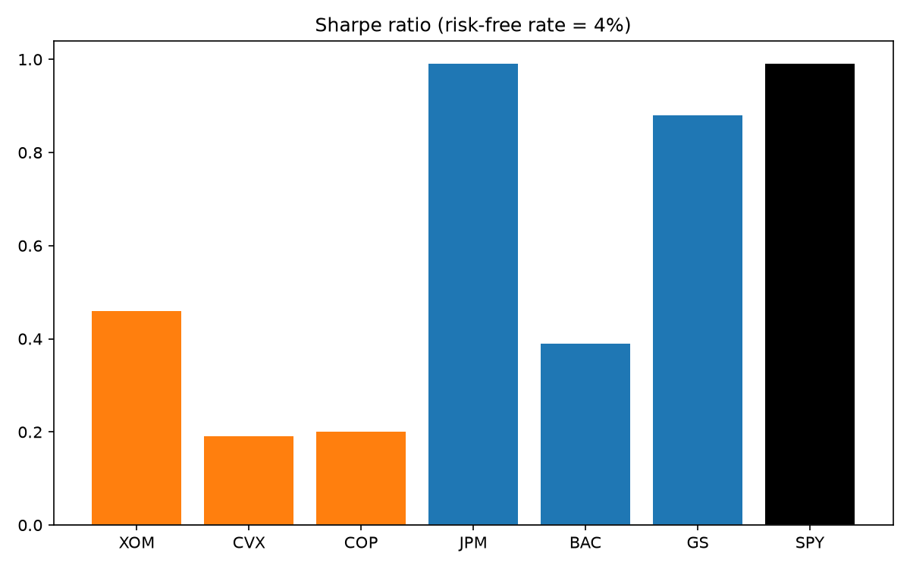

# Equity Research with Python

A personal project analyzing stock and sector performance with Python and open-source financial tools.

## Project 1: Energy vs. Financials sector risk analysis

**Tools:** Python, pandas, Matplotlib, [OpenBB Platform](https://github.com/OpenBB-finance/OpenBB) (Yahoo Finance data)

**Question:** Since January 2023, which sector rewarded investors better, Energy or Financials, after accounting for risk?

**Stocks:** Energy (XOM, CVX, COP), Financials (JPM, BAC, GS), benchmark S&P 500 (SPY)

**Metrics calculated:** total return, CAGR, annualized volatility, Sharpe ratio (4% risk-free rate), maximum drawdown, beta vs. S&P 500

### Results (sector = equal-weighted average of its three stocks)

| Sector | Total Return | CAGR | Volatility | Sharpe | Max Drawdown | Beta |
|---|---|---|---|---|---|---|
| Financials | 122.78% | 22.45% | 25.63% | 0.75 | -29.23% | 1.04 |
| S&P 500 (SPY) | 98.81% | 19.57% | 15.09% | 0.99 | -19.00% | 1.00 |
| Energy | 35.86% | 8.14% | 25.53% | 0.28 | -29.18% | 0.35 |

### Key findings
1. **Financials outperformed the market on raw return** (22.5% vs. 19.6% annualized), led by Goldman Sachs (+163.9%).
2. **The market won on a risk-adjusted basis.** Financials were ~70% more volatile than the S&P 500, giving a lower Sharpe ratio (0.75 vs. 0.99).
3. **Energy showed low market sensitivity (beta 0.35)**, suggesting diversification value despite weaker returns.

Full per-stock results: [`sector_metrics.csv`](01_openbb_analysis/sector_metrics.csv)

### How to run
    python3.12 -m venv .venv
    source .venv/bin/activate
    pip install -r requirements.txt
    python 01_openbb_analysis/sector_analysis.py

*For learning and research only, not investment advice.*