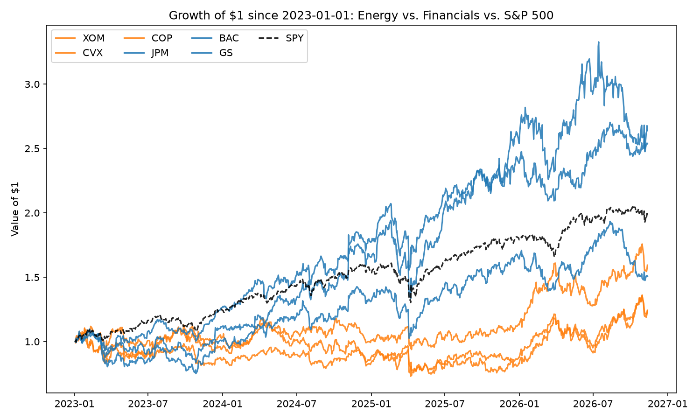
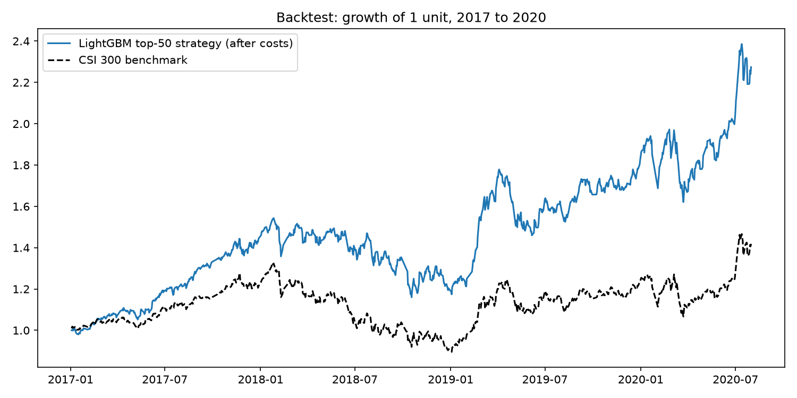

# Equity Research with Python

A personal project analyzing stock and sector performance with Python and open-source financial tools.

## Project 1: Energy vs. Financials sector risk analysis

**Tools:** Python, pandas, Matplotlib, [OpenBB Platform](https://github.com/OpenBB-finance/OpenBB) (Yahoo Finance data)

**Question:** Since January 2023, which sector rewarded investors better, Energy or Financials, after accounting for risk?

**Stocks:** Energy (XOM, CVX, COP), Financials (JPM, BAC, GS), benchmark S&P 500 (SPY)

**Metrics calculated:** total return, CAGR, annualized volatility, Sharpe ratio (4% risk-free rate), maximum drawdown, beta vs. S&P 500

### Results (sector = equal-weighted average of its three stocks)

| Sector | Total Return | CAGR | Volatility | Sharpe | Max Drawdown | Beta |
|---|---|---|---|---|---|---|
| Financials | 122.78% | 22.45% | 25.63% | 0.75 | -29.23% | 1.04 |
| S&P 500 (SPY) | 98.81% | 19.57% | 15.09% | 0.99 | -19.00% | 1.00 |
| Energy | 35.86% | 8.14% | 25.53% | 0.28 | -29.18% | 0.35 |

### Key findings
1. **Financials outperformed the market on raw return** (22.5% vs. 19.6% annualized), led by Goldman Sachs (+163.9%).
2. **The market won on a risk-adjusted basis.** Financials were ~70% more volatile than the S&P 500, giving a lower Sharpe ratio (0.75 vs. 0.99).
3. **Energy showed low market sensitivity (beta 0.35)**, suggesting diversification value despite weaker returns.

Full per-stock results: [`sector_metrics.csv`](01_openbb_analysis/sector_metrics.csv)

### How to run
    python3.12 -m venv .venv
    source .venv/bin/activate
    pip install -r requirements.txt
    python 01_openbb_analysis/sector_analysis.py
## Project 2: Machine learning stock-selection backtest

**Tools:** Python, [Microsoft Qlib](https://github.com/microsoft/qlib), LightGBM, MLflow

**Question:** Can a machine learning model trained on price and volume patterns pick stocks that beat the market after trading costs?

**Method**
- **Universe:** CSI 300 (China's 300 largest stocks), daily data from Qlib's community dataset
- **Features:** 158 technical factors (Qlib Alpha158: momentum, volatility, volume, price patterns)
- **Model:** LightGBM gradient-boosted trees predicting next-period returns. Trained 2008–2014, validated 2015–2016, tested 2017–Jul 2020
- **Strategy:** each day hold the model's top 50 stocks and swap out up to 5. Trading costs of 0.05% to buy and 0.15% to sell are included.

### Results (test period, 2017 – Jul 2020)

| Metric | Without costs | With costs |
|---|---|---|
| Annualized excess return vs. CSI 300 | 17.3% | **13.6%** |
| Information ratio | 2.01 | **1.58** |
| Max drawdown (excess return) | -7.6% | **-8.3%** |

Signal quality: **IC 0.048**, Rank IC 0.050 (correlation between predicted and actual next-day returns)

**Takeaway:** a weak signal (IC ≈ 0.05), applied consistently across 300 stocks, produced steady outperformance (information ratio 1.58). Trading costs reduced excess returns by about 3.7 points a year, which shows why realistic cost assumptions matter in backtesting. Limitation: this tests one historical period in one market. Past backtest performance doesn't guarantee future results.

### How to run
    python3.12 -m venv .venv-qlib && source .venv-qlib/bin/activate
    pip install -r 02_qlib_ml_backtest/requirements.txt
    # download data: see https://github.com/microsoft/qlib#data-preparation
    cd 02_qlib_ml_backtest
    MLFLOW_ALLOW_FILE_STORE=true qrun workflow_config_lightgbm_Alpha158.yaml
    cd .. && python 02_qlib_ml_backtest/summarize_results.py

*For learning and research only, not investment advice.*